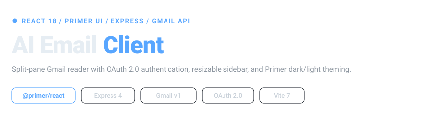
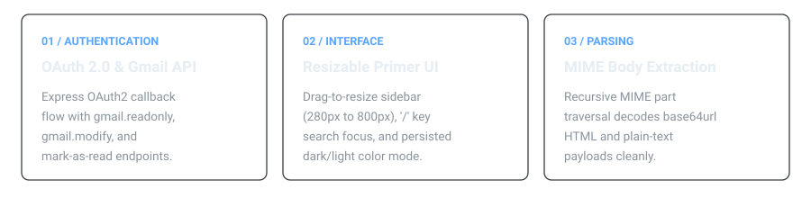
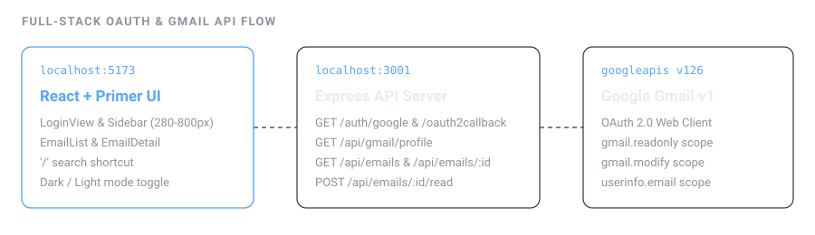

<p align="center">
  
</p>

<p align="center">
  <a href="#prerequisites">Prerequisites</a> &middot;
  <a href="#setup--installation">Setup</a> &middot;
  <a href="#architecture">Architecture</a> &middot;
  <a href="#api-endpoints">API Endpoints</a>
</p>

---

## Overview

**AI Email Client** is a full-stack Gmail reader built with a **React 18 + GitHub Primer (`@primer/react`)** frontend and an **Express + `googleapis`** backend. It authenticates via Google OAuth 2.0, fetches paginated inbox threads, extracts HTML and plain-text MIME payloads, and renders a split-pane reading workspace with a resizable sidebar and persistent dark/light theme.

---

## Features

<p align="center">
  
</p>

- **Google OAuth 2.0 Flow**: Authenticates against Gmail API (`gmail.readonly`, `gmail.modify`, `userinfo.email`).
- **Resizable Split-Pane Workspace**: Drag-to-resize sidebar (`280px` to `800px`) persisted in `localStorage`.
- **Keyboard-First Search**: Press `/` anywhere outside inputs to focus the search bar.
- **Dark & Light Primer Modes**: Toggle between Primer dark (`#0d1117` / `#000000`) and light (`#f6f8fa` / `#ffffff`) themes.
- **Recursive MIME Parsing**: Decodes nested `text/html` and `text/plain` message parts and strips HTML entities for clean previews.

---

## Architecture

<p align="center">
  
</p>

### Tech Stack

| Layer | Technology |
|---|---|
| Frontend | React 18, Vite 7, `@primer/react` 36, `@primer/octicons-react`, `styled-components` |
| Backend | Node.js, Express 4, `googleapis` 126, `cors`, `dotenv` |
| Auth | Google OAuth 2.0 Web Application flow |

---

## Prerequisites

1. **Node.js & npm** installed locally.
2. **Google Cloud Project** with the **Gmail API** enabled:
   - Go to [Google Cloud Console](https://console.cloud.google.com/) and create a project.
   - Under **APIs & Services > Library**, enable **Gmail API**.
   - Under **APIs & Services > OAuth consent screen**, select **External**, fill in app details, and add your Gmail address under **Test users**.
   - Under **APIs & Services > Credentials**, create an **OAuth client ID** (type: **Web application**) with authorized redirect URI:
     ```text
     http://localhost:3001/oauth2callback
     ```
   - Copy your **Client ID** and **Client Secret**.

---

## Setup & Installation

### 1. Configure Environment Variables

Create `backend/.env` with your Google OAuth credentials:

```env
GOOGLE_CLIENT_ID=your_google_client_id
GOOGLE_CLIENT_SECRET=your_google_client_secret
REDIRECT_URI=http://localhost:3001/oauth2callback
PORT=3001
```

### 2. Install Dependencies

Run the provided setup script from the repository root:

```bash
chmod +x setup.sh start.sh
./setup.sh
```

Or install manually in each directory:

```bash
cd backend && npm install
cd ../frontend && npm install
```

### 3. Run the Application

Use the dev launcher script (starts backend on `3001` and frontend on `5173`, automatically finding free ports if needed):

```bash
./start.sh dev
```

Or start each server separately:

```bash
# Terminal 1 - Backend (http://localhost:3001)
cd backend && npm start

# Terminal 2 - Frontend (http://localhost:5173)
cd frontend && npm run dev
```

Open `http://localhost:5173`, sign in with your Google test-user account, and browse your inbox.

---

## API Endpoints

| Method | Endpoint | Description |
|---|---|---|
| `GET` | `/auth/url` | Returns the Google OAuth 2.0 consent URL |
| `GET` | `/auth/google` | Redirects to Google OAuth 2.0 sign-in |
| `GET` | `/oauth2callback` | Handles OAuth callback and redirects to `http://localhost:5173/` |
| `GET` | `/api/gmail/profile` | Checks authentication and returns the user's Gmail profile |
| `GET` | `/api/emails` | Lists recent emails with decoded headers and snippets |
| `GET` | `/api/emails/:id` | Fetches full decoded HTML and plain-text body for a message |
| `POST` | `/api/emails/:id/read` | Marks a message as read |

---

## Project Structure

```text
AI-Email-Client/
├── SETUP_INSTRUCTIONS.md
├── setup.sh                      # Installs backend & frontend dependencies
├── start.sh                      # Starts dev servers (./start.sh dev)
├── backend/
│   ├── package.json
│   └── server.js                 # Express + googleapis OAuth & Gmail API server
└── frontend/
    ├── package.json
    ├── vite.config.js
    └── src/
        ├── App.jsx               # Main workspace, search shortcut, theme & resize state
        ├── main.jsx
        └── components/
            ├── LoginView.jsx     # OAuth sign-in screen
            ├── Sidebar.jsx       # Resizable navigation & inbox header
            ├── EmailList.jsx     # Message list
            └── EmailDetail.jsx   # Message body viewer
```
